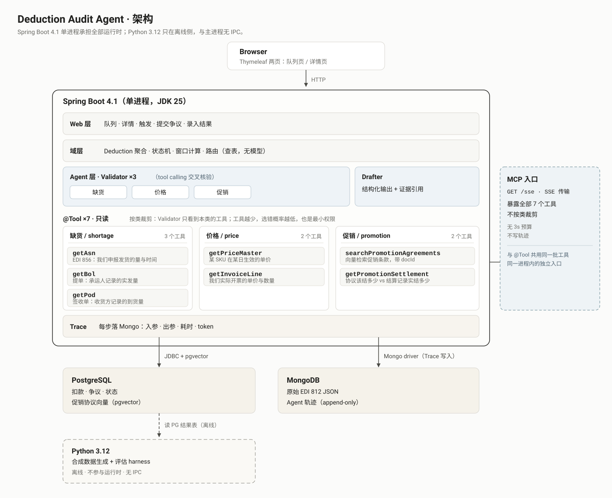

# Deduction Audit Agent

[](https://github.com/romeokeita231/Deduction-audit-agent/actions/workflows/ci.yml)

[中文](README.zh.md) | English

A retailer takes money out of a CPG supplier's payable invoice and attaches a reason
code. This system decides, for one deduction, whether it stands, whether it is worth
disputing, how much of the dispute window is left, and drafts the dispute with evidence.

## Why this is an Agent, not a RAG question-answering system

**The input is one deduction, not a passage of text.** A RAG pipeline is handed a
question and a corpus. Here the unit of work is a deduction row: amount, date, reason
code, invoice, PO. There is no question to embed and no passage to retrieve; the
retrieval that matters is asking operational systems for facts about one shipment.

**The middle must call tools, because the sources contradict each other.** For a
shortage deduction the retailer argues from EDI 812, while the supplier's ASN says what
it shipped, the carrier's BOL says what left the dock, and the receiver's POD says what
arrived. Any two can disagree, and 812 arbitrates nothing: it is the claim under
examination, not a referee. Price deductions compare the invoice line with a
date-effective price master; promotion deductions compare the agreement with the
settlement record. The Agent must fetch each source, see the disagreement, and apply the
written policy that says which source wins. Averaging the numbers is not a verdict.

**The output is a verdict, an evidence set, and a dispute document.** The verdict is one of
four labeled outcomes, including two kinds of "I do not know": missing evidence and no
rule to decide. The evidence set is a closed list of stable IDs the model had to cite; the
document's structure is projected from the verdict and only the prose is model-written.

## Quickstart

Requires Docker and JDK 25. The Maven wrapper brings Maven; on Windows use `.\mvnw.cmd`.

```powershell
docker compose up -d
./mvnw spring-boot:run
```

Open `http://localhost:8080/` and it lands on the queue page. Evaluating a deduction
calls an OpenAI-compatible model, so set `MODEL_API_KEY` (falling back to
`DEEPSEEK_API_KEY`); promotion search additionally needs `EMBEDDING_API_KEY` (falling
back to `DASHSCOPE_API_KEY`). Stop and wipe the stores with `docker compose down -v`.

CI runs the pipeline on recorded fixtures and does not call a model; the live evaluation
workflow is under [Reproducing the numbers](#reproducing-the-numbers).

## What it does

- **Three deduction categories.** Shortage/damage, price variance and promotion. Each
  has its own validator and its own reasoning mechanism, not one generic prompt.
- **Routing is a table, not a model.** A reason code maps to a category; an unmapped code
  parks the deduction. No LLM classifies or routes.
- **Tools are trimmed per category.** Seven read-only tools exist, and the model only
  sees the ones its category needs. Every returned value carries a stable `evidence_id`.
- **EDI 812 is not a tool.** The retailer's adjustment is the claim under examination and
  lives in the prompt; it has no authority over BOL or POD. When those disagree and no
  policy rule arbitrates, the correct answer is `INCONCLUSIVE`.
- **Verdicts express doubt.** `DEDUCTION_STANDS`, `DISPUTABLE` and `INCONCLUSIVE`, with
  `INCONCLUSIVE` split into missing evidence versus no arbitrating rule. The two causes
  lead to different parking reasons and different human follow-up.
- **The state machine owns the timeline.** Ten states, sixteen transitions and seven
  invariants. The dispute window is a `LocalDate` in the retailer's time zone; expiry is
  both scheduled and checked lazily on every transition; the queue sorts by days
  remaining and keeps parked rows in the sort.
- **The document has two authors.** The structured `claim` is projected from the verdict,
  the `narrative` is written by the model, and the `digest` is frozen with an evidence
  version. Five deterministic checks run before anything is persisted.
- **Every tool call is traceable.** MongoDB records input, output, duration and tokens,
  including failed draft rounds; the detail page renders the timeline.
- **Two server-rendered pages.** A queue with status and category filters, and a detail
  page with evidence, verdict, trace and document. No JavaScript build chain.
- **An MCP entry point.** `GET /sse` exposes all seven tools to a client without category
  trimming, the 3s tool budget or tracing; trimming belongs to the validator path.
- **Evaluation is offline and Python-only.** A synthetic conflict-matrix corpus and a
  harness produce the numbers; Python never runs inside the service and has no IPC with
  it.

## Architecture



One Spring Boot 4.1 process on JDK 25 carries the whole runtime. PostgreSQL 16 with
pgvector stores deductions, disputes, transitions and promotion vectors; MongoDB stores
the raw EDI 812 documents and append-only agent traces. Python 3.12 sits off to the side,
generating corpus data and computing metrics from the PostgreSQL result tables.

The full layer diagram, the tool-to-category table and the endpoint list are in
[ARCHITECTURE.md](docs/ARCHITECTURE.md).

Time budget for one evaluation: 30 seconds at p95 and a 45 second hard deadline, both for
the deduction as a whole rather than per attempt. A single tool call gets 3 seconds, a
single model round gets 12 seconds, an evaluation allows at most 6 tool calls, and a retry
happens at most once, only when more than 12 seconds of budget remain. Retries cover
infrastructure failures, never an unsatisfactory verdict.

## State machine

One deduction has one state machine; a dispute has none of its own. Ten states, thirteen
transitions, seven invariants, and `INCONCLUSIVE` can never become `DISPUTED`. `PARKED` is
one state with four distinguishable reasons: unmapped code, evaluation failure, missing
evidence, or a policy gap. Expiry has both a nightly scan and a lazy check so that a
stopped scheduler cannot let an expired deduction through. See
[STATE-MACHINE.md](docs/STATE-MACHINE.md) for the tables and invariants.

## Evaluation

All numbers below are copied from the [report for commit `4d9dc43`](docs/eval/reports/2026-10-31-4d9dc43/report.md):
105 corpus cases, `schemaVersion` 2, live mode against a real model, with the corpus and
oracle frozen.

- **Verdict agreement** at `4d9dc43`: micro exact-match **63/105**.
- **Four-state recall** at `4d9dc43`, one-vs-rest: `DEDUCTION_STANDS` **20/30**,
  `DISPUTABLE` **22/33**, `EVIDENCE_GAP` **14/21**, `POLICY_GAP` **7/21**.
- **Exact-match per category** at `4d9dc43`: `SHORTAGE` **28/35**, `PRICE_VARIANCE`
  **28/35**, `PROMOTION` **7/35**.
- **Evidence citation** at `4d9dc43`, computed only on `claim.supportingEvidence`:
  precision **28/28** and recall **28/28**. The denominator is the 33 cases the oracle
  marked `DISPUTABLE`; 14 cases actually produced a claim and none of those had zero
  citations.
- **Document structure** at `4d9dc43`: structural pass **20/21**, where the denominator
  contains only documents actually produced. **Production rate 21/33**: documents
  produced over cases the oracle marked `DISPUTABLE`. The two numbers are never
  multiplied; one is conditional on production, the other is production.

The structural predicate was corrected in the same report: 11/21 before, 20/21 after.
The report names the nine cases that moved, the two false-negative patterns behind them,
and the one remaining real violation, a document that states the amount twice.

## Integrity

- Business rules and figures come from public industry material. All data in this
  repository is synthetic, and the author has no CPG industry experience.
- The metrics measure policy execution, not judgment. A high number means the Agent
  applies written policy consistently, not that it would judge a real deduction like an
  experienced AR analyst.
- A green CI means the pipeline is correct, not that the model has not regressed. CI
  replays fixtures and does not call a model, so model quality is only measured by a live
  evaluation run such as the one above.

## Reproducing the numbers

From the [report](docs/eval/reports/2026-10-31-4d9dc43/report.md), against a clean
database, with model credentials set:

```powershell
mvn -P live spring-boot:run
python -m eval.metrics target/eval/results.ndjson --report docs/eval/reports --commit 4d9dc43 --mode live
```

`metrics.json` pins the corpus and policy hashes, the commit SHA and the schema version
alongside the numbers. Re-running against a used Docker volume collides on case-derived
keys, so start clean and finish with `docker compose down -v`.

## What it deliberately does not do

No compliance-logistics or administrative deductions, no Elasticsearch, Redis, message
queue or microservices, no React front end, no real authentication or multi-tenancy, no
real EDI or retailer API integration, and no LLM in routing or classification. Each cut
is a judgment rather than an oversight; the reasons are in
[PLAN.md](docs/PLAN.md), section 3.

## Documentation

- [Glossary](GLOSSARY.md): the vocabulary this system uses, and the words it avoids
- [Scope and milestones](docs/PLAN.md): what it does and what it deliberately does not
- [Architecture](docs/ARCHITECTURE.md) and its [diagram](docs/assets/architecture.svg)
- [State machine](docs/STATE-MACHINE.md)
- [Decision records](docs/adr/): ADR 0001 to 0009
- [Design Q&A](docs/QA.md): twenty questions the design has to answer
- [Evaluation report at `4d9dc43`](docs/eval/reports/2026-10-31-4d9dc43/report.md)
