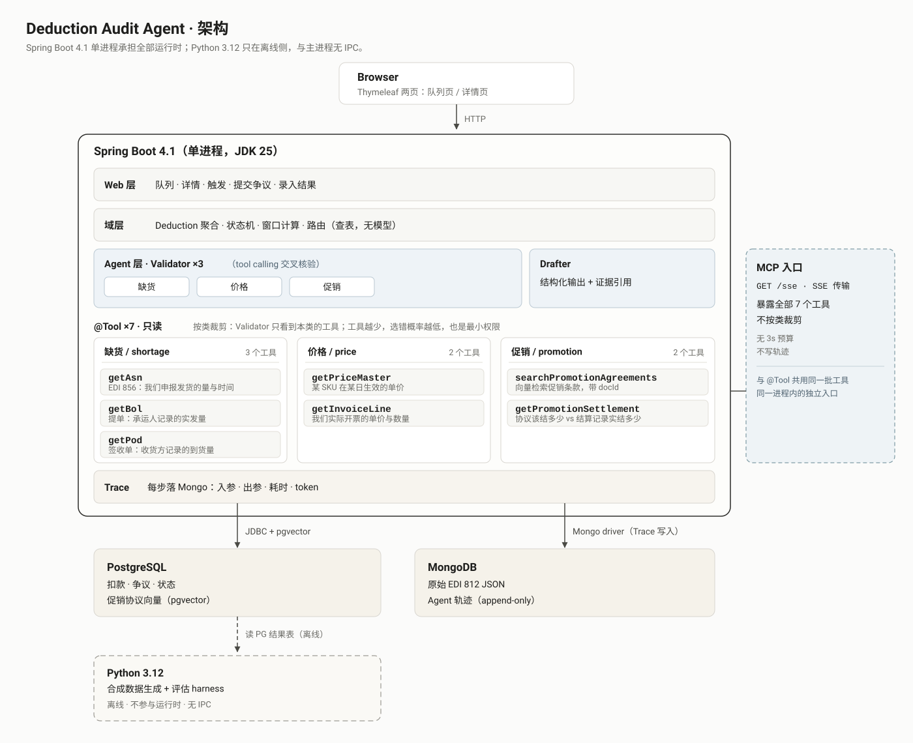

# 扣款稽核 Agent

中文 | [English](README.md)

[](https://github.com/romeokeita231/Deduction-audit-agent/actions/workflows/ci.yml)

零售商从消费品供应商（CPG）的应付货款里扣走一笔钱、附上一个原因码。本系统针对一笔扣款判断它是否成立、值不值得争、争议窗口还剩多久，并起草一份带证据的争议文书。

## 为什么它是 Agent，而不是 RAG 问答系统

**输入是一笔扣款，不是一段文本。** RAG 管线拿到的是一个问题和一批语料；这里的工作单元是一行扣款：金额、日期、原因码、发票、PO。没有可嵌入的问题，也没有可检索的段落；真正要检索的，是向业务系统索取某一次发货的事实。

**中间必须调工具，因为几份数据源互相矛盾。** 缺货类扣款里，零售商拿 EDI 812 说话；供应商的 ASN 说自己发了多少，承运人的 BOL 说离港时是多少，收货方的 POD 说到手是多少。任意两份都可能打架，而 812 不仲裁任何一方：它是被审查的主张，不是裁判。价格类扣款拿发票行与带生效区间的价目主数据相比；促销类扣款拿协议与结算记录相比。Agent 必须把每一份取回来、看见它们的分歧、再套用写明哪份优先的成文政策。把数字平均掉不构成裁决。

**输出是一个判定、一个证据集、一份争议文书。** 判定是 4 种带标记的结论之一，其中包含两种不同的"我不知道"：证据缺失，与无规则可裁。证据集是一张封闭清单，列出模型必须引用的稳定 ID。文书的结构由判定确定性投影而来，模型只写正文。这是一份带契约的 Agent，不是一段生成的答案。

## 快速开始

需要 Docker 与 JDK 25。Maven 由 wrapper 提供；Windows 上用 `.\mvnw.cmd`。

```powershell
docker compose up -d
./mvnw spring-boot:run
```

打开 `http://localhost:8080/`，会落到队列页。评估一笔扣款会调用兼容 OpenAI 的模型，所以要设置 `MODEL_API_KEY`（回退到 `DEEPSEEK_API_KEY`）；促销检索另需 `EMBEDDING_API_KEY`（回退到 `DASHSCOPE_API_KEY`）。停止并清空存储用 `docker compose down -v`。

CI 在录制的 fixture 上跑管线，不调用模型；live 评估的流程见[复现这些数字](#复现这些数字)。

## 它做什么

- **3 类扣款。** 缺货/损坏、价格差异、促销。每一类有自己的校验器与自己的推理机制，不是一条通用的 prompt。
- **路由是一张表，不是模型。** 原因码映射到类别；映射不到的码把扣款停进 `PARKED`。没有任何 LLM 参与分类或路由。
- **工具按类别裁剪。** 系统共有 7 个只读工具，模型只看见它这一类需要的那些。每个返回值都带稳定的 `evidence_id`。
- **EDI 812 不是工具。** 零售商的调整单是被审查的主张，放在 prompt 里；它对 BOL 与 POD 没有裁决权。当两者不一致且没有政策条款可裁时，正确答案是 `INCONCLUSIVE`。
- **判定会表达"拿不准"。** `DEDUCTION_STANDS`、`DISPUTABLE`、`INCONCLUSIVE`，其中 `INCONCLUSIVE` 再分为证据缺失与无规则可裁。两种成因对应不同的停靠原因，也需要人做不同的跟进。
- **状态机拥有时间线。** 10 个状态、16 条转移、7 条不变量。争议窗口是零售商时区里的一个 `LocalDate`；到期既由定时扫描检查，也在每次转移时惰性检查；队列按剩余天数排序，停靠的行留在排序里。
- **文书有两个作者。** 结构化的 `claim` 由判定投影而来，`narrative` 由模型撰写，`digest` 与证据版本一起冻结。落库之前跑 5 条确定性校验。
- **每次工具调用都可追溯。** MongoDB 记录入参、出参、耗时与 token，包括失败的起草轮次；详情页渲染出这条时间线。
- **两个服务端渲染的页面。** 一个带状态与类别筛选的队列页，一个带证据、判定、轨迹与文书的详情页。没有 JavaScript 构建链。
- **一个 MCP 入口。** `GET /sse` 把 7 个工具全部暴露给客户端，不做类别裁剪、不受 3s 工具预算、不写轨迹；裁剪是校验器那条路径的性质。
- **评估是离线、纯 Python 的。** 一份合成的冲突矩阵语料加一个 harness 产出这些数字；Python 从不进入服务进程，与它也没有 IPC。

## 架构



运行时整体是一个 JDK 25 上的 Spring Boot 4.1 进程。PostgreSQL 16 加 pgvector 存扣款、争议、转移与促销向量；MongoDB 存原始 EDI 812 文档与只追加的 Agent 轨迹。Python 3.12 在旁侧离线运行，负责生成语料数据、从 PostgreSQL 结果表计算指标。

完整的层次图、工具与类别的对照表、端点清单见 [ARCHITECTURE.md](docs/ARCHITECTURE.md)。

一次评估的时间预算：p95 目标 30 秒、硬截止 45 秒，两者都是整笔扣款的预算，不是单次尝试的预算。单次工具调用 3 秒，单次模型往返 12 秒，一次评估最多 6 次工具调用；重试至多 1 次，且只在剩余预算超过 12 秒时发生。重试只覆盖基础设施故障，从不用于换取一个更令人满意的裁决。

## 状态机

一笔扣款只有一台状态机，争议没有自己的状态机。10 个状态、16 条转移、7 条不变量，且 `INCONCLUSIVE` 永远不会变成 `DISPUTED`。`PARKED` 是一个状态、4 种可区分的原因：原因码未映射、评估失败、证据缺失、政策空白。到期既有夜间扫描也有惰性检查，所以调度器停了也不会放过一笔已逾期的扣款。表与不变量见 [STATE-MACHINE.md](docs/STATE-MACHINE.md)。

## 评估

以下数字全部抄自 [commit `4d9dc43` 的评估报告](docs/eval/reports/2026-10-31-4d9dc43/report.md)：105 条语料、`schemaVersion` 2、对真实模型的 live 模式，语料与 oracle 已冻结。

- **判决一致率**，`4d9dc43`：micro exact-match **63/105**。
- **四态召回率**，`4d9dc43`，one-vs-rest：`DEDUCTION_STANDS` **20/30**、`DISPUTABLE` **22/33**、`EVIDENCE_GAP` **14/21**、`POLICY_GAP` **7/21**。
- **按类别的 exact-match**，`4d9dc43`：`SHORTAGE` **28/35**、`PRICE_VARIANCE` **28/35**、`PROMOTION` **7/35**。
- **证据引用**，`4d9dc43`，只在 `claim.supportingEvidence` 上计算：precision **28/28**、recall **28/28**。分母是 oracle 判为 `DISPUTABLE` 的 33 条；实际产出 claim 的有 14 条，其中没有一条零引用。
- **文书结构**，`4d9dc43`：结构合格率 **20/21**，分母只含实际产出的文书。**产出率 21/33**：分子是实际产出的文书数，分母是 oracle 判为 `DISPUTABLE` 的条数。两个数永不相乘：一个以产出为条件，一个就是产出本身。

同一份报告里修正了结构判据：修正前 11/21，修正后 20/21。报告点名了移动的 9 条 case、它们背后的两种假阴性模式，以及剩下 1 条真实违规——一份把金额写了两遍的文书。

## 诚信边界

- 业务规则与数字来自公开行业资料。本仓库中的所有数据均为合成数据，作者没有 CPG 行业从业经验。
- 指标测的是政策执行力，不是判断力。数字高只说明 Agent 一贯地执行了成文政策，不说明它能像一名资深 AR 分析师那样去判断一笔真实的扣款。
- CI 绿灯只代表管线正确，不代表模型没有退化。CI 回放 fixture，不调用模型，所以模型质量只能由上面那样的 live 评估运行来衡量。

## 复现这些数字

按[报告](docs/eval/reports/2026-10-31-4d9dc43/report.md)，在干净的数据库上、配置好模型凭据后：

```powershell
mvn -P live spring-boot:run
python -m eval.metrics target/eval/results.ndjson --report docs/eval/reports --commit 4d9dc43 --mode live
```

`metrics.json` 把语料哈希、政策哈希、commit SHA 与 schema 版本和这些数字钉在一起。对已用过的 Docker volume 重跑，会在由 case 派生的键上冲突，所以要干净地开始，最后用 `docker compose down -v` 收尾。

## 它刻意不做什么

不做合规物流类与管理类扣款，不用 Elasticsearch、Redis、消息队列或微服务，不做 React 前端，不做真实的鉴权与多租户，不接真实的 EDI 或零售商 API，路由与分类里也没有 LLM。每一处删减都是判断，不是疏忽；理由在 [PLAN.md](docs/PLAN.md) 第 3 节。

## 文档

- [术语表](GLOSSARY.md)：这套系统使用哪些词，以及它刻意回避哪些词
- [范围与里程碑](docs/PLAN.md)：它做什么，以及它刻意不做什么
- [架构](docs/ARCHITECTURE.md)及其[架构图](docs/assets/architecture.svg)
- [状态机](docs/STATE-MACHINE.md)
- [决策记录](docs/adr/)：ADR 0001–0009
- [设计问答](docs/QA.md)：设计必须回答的 20 个问题
- [commit `4d9dc43` 的评估报告](docs/eval/reports/2026-10-31-4d9dc43/report.md)
